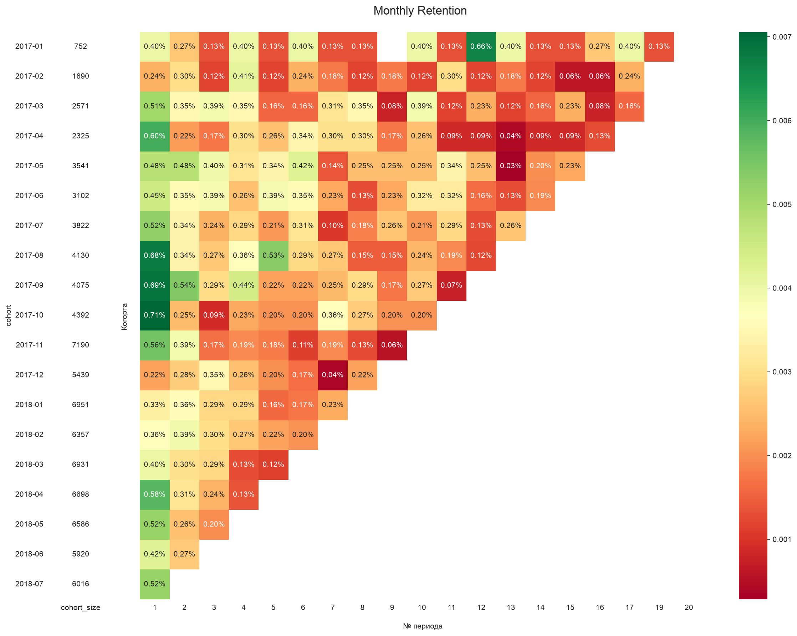

# Продуктовая аналитика маркетплейса

Проект по анализу нового маркетплейса, продающего бразильские товары.
Цель — оценить состояние продукта, найти точки роста и предложить гипотезу
для увеличения прибыли.

Учебный проект в рамках курса "Аналитик данных" от [Karpov.Courses](https://karpov.courses/).

## Задачи проекта

1. Оценить месячный retention через когортный анализ.
2. Определить наличие product/market fit.
3. Выбрать 5 ключевых метрик для фокуса продакта.
4. Выбрать гипотезу роста по фреймворку ICE.
5. Сформулировать метрики для выбранной гипотезы.
6. Собрать итоговый отчёт.

## Данные

Файлы, используемые в проекте (хранятся на Яндекс.Диске):

| Файл | Описание |
|---|---|
| `olist_customers_dataset.csv` | Пользователи |
| `olist_orders_dataset.csv` | Заказы |
| `olist_order_items_dataset.csv` | Товарные позиции |

## Структура репозитория

```
.
├── project.ipynb              # основной ноутбук с анализом
├── images/                    # сохранённые графики для отчёта
├── report.md                  # текстовый отчёт с выводами
└── README.md
```

## Инструменты

- **Язык:** Python 3.13
- **Библиотеки:**
  - `requests`, `urllib.parse` - считывание данных
  - `pandas`, `numpy`, `operator` — обработка данных
  - `matplotlib`, `seaborn` — визуализация
- **Среда разработки:** Jupyter Notebook

## Ключевые результаты

- Медиана retention 1-го месяца — **0,51%**.
- **~97%** клиентов совершают только один заказ → PMF отсутствует.
- Доля задержанных заказов — 6,77%, медиана задержки — 7 дней.
- По ICE выбрана гипотеза: **исправление бага в процессинге заказов** (ICE = 240).


*Рис. 1. Тепловая карта Retention по когортам*

## Выводы

- Маркетплейс на ранней стадии, product/market fit не достигнут.
- Приоритетная гипотеза — устранение бага в процессинге заказов.
- Подробные выводы и метрики — в report.md.

## Автор

Науменко Михаил
