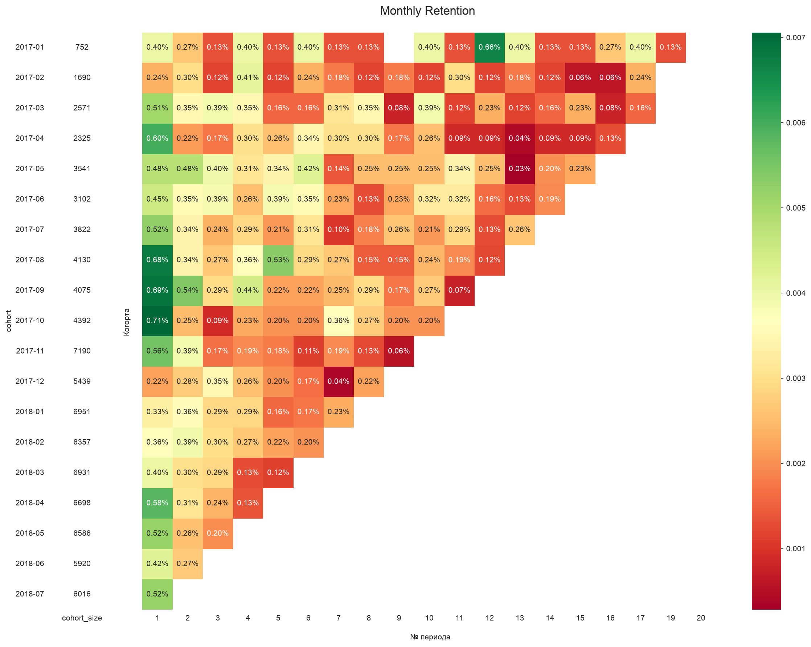
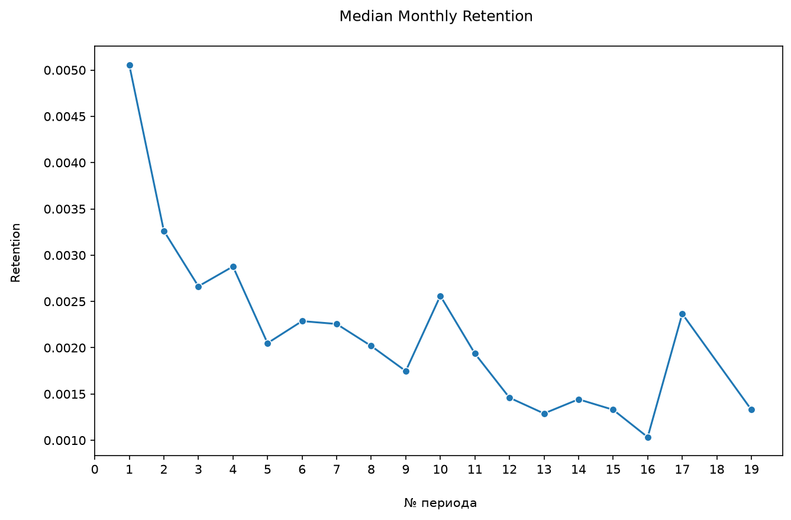
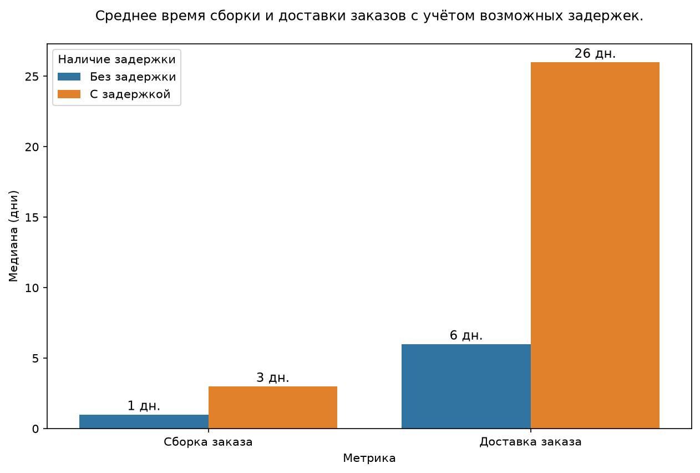
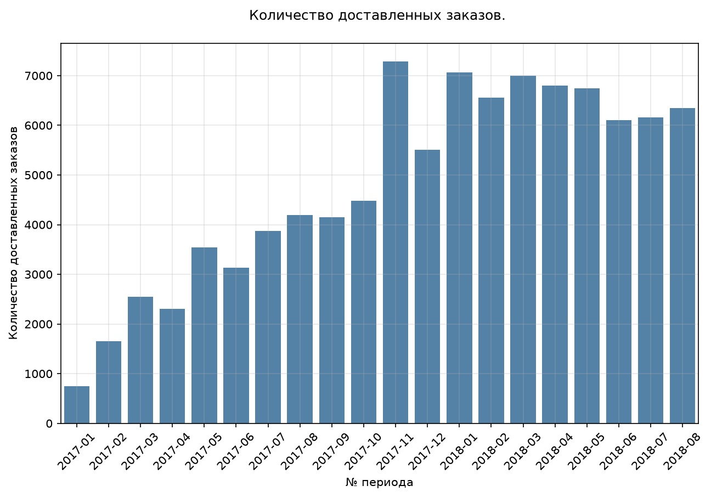
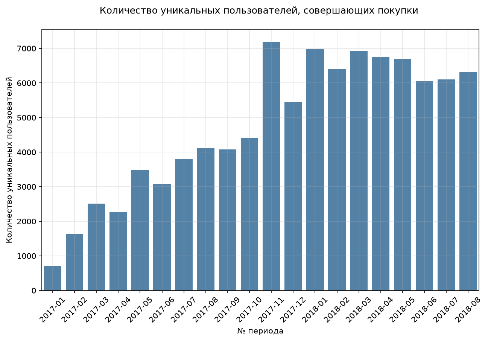
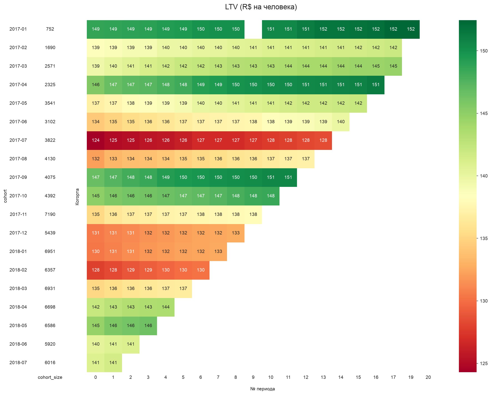

# Отчёт по продуктовой аналитике маркетплейса

## Введение

Проведен анализ нового маркетплейса по продаже бразильских товаров. Цель работы — оценить текущее состояние продукта, выявить проблемы и предложить точку роста для увеличения прибыли. В ходе анализа использовались данные о заказах, клиентах и товарах за период с 2016 по 2018 год. Инструменты: Python (pandas, seaborn, matplotlib).

Учебный проект в рамках курса "Аналитик данных" от [Karpov.Courses](https://karpov.courses/).

---

## Задача 1. Когортный анализ Retention

Был рассчитан месячный retention по неотмененным заказам (исключены статусы `canceled` и `unavailable`). Дата заказа — `order_purchase_timestamp`. Когорта присваивалась по первому месяцу покупки клиента.

*Рис. 1. Тепловая карта Retention по когортам*

*Рис. 2. Медианный Retention по месяцам*

**Выводы:**
- Медиана retention 1-го месяца — 0,51%. Это означает, что из ~1000 новых клиентов возвращается всего около 5 человек. Для маркетплейса это критически низкий показатель: здоровая норма для e-commerce — 15–30% на второй месяц.
- Динамика retention по когортам не улучшается со временем: когорты 2018 года показывают те же значения, что и когорты 2017 года. Это говорит о том, что проблема носит системный, а не разовый характер — она не связана с отдельной акцией или сезонностью.
- Наибольший retention 3-го месяца зафиксирован в когорте 2017-05. Это может быть связано с ростом ассортимента или маркетинговой активностью в тот период. Однако даже этот «лучший» результат остаётся в пределах 0,4–0,5% — то есть выделить успешную практику не получается.
- Начиная с 12-го месяца retention падает практически до нуля. Клиенты не возвращаются даже спустя год, что подтверждает отсутствие долгосрочной лояльности.

**Итог:** продукт не удерживает клиентов ни в короткой, ни в длинной перспективе. Без роста retention любые инвестиции в привлечение трафика будут убыточны — стоимость привлечения (CAC) не окупается.

---

## Задача 2. Оценка Product/Market Fit

PMF оценивался по трём признакам:
- Уровень retention 1-го месяца.
- Доля клиентов, совершающих повторные покупки.
- Качество клиентского опыта (логистика, отмены).

*Рис. 3. Медианное значение retention 1-го месяца*

*Рис. 4. Сравнение времени сборки и доставки для заказов с задержкой и без*

**Выводы по задаче:** 
- ~97% клиентов совершают только один заказ. Это ключевой сигнал отсутствия PMF. В здоровом маркетплейсе доля повторных покупателей — 30–50%, здесь — менее 3%.
- Среднее время доставки — 9 дней, что выглядит довольно большим сроком, в сочетании с 6,77% задержек создаёт негативный опыт у части клиентов. При задержке она растёт в среднем на 7 дней, то есть клиент ждёт товар почти в два раза дольше.
- Основная часть задержек формируется на этапе доставки, а не на этапе сборки заказа. Значит, корень проблемы — в логистических партнёрах, а не в работе склада.
- Проблема не в цене и не в ассортименте: клиенты делают первую покупку охотно, но не возвращаются. Это классический признак того, что первый опыт не оправдывает ожиданий.

**Итог:** PMF отсутствует. Продукт решает разовую задачу («купить бразильский товар»), но не становится привычным каналом покупок. Для достижения PMF нужно сначала исправить клиентский опыт — иначе любые вложения в рост приведут только к росту оттока.

**Рекомендации:**
- Повысить retention до 5–10% прежде, чем масштабировать маркетинг.
- Сократить среднее время доставки и уменьшить долю задержек, работая с логистическими партнёрами.
- Начать работу над возвратом клиентов.

---

## Задача 3. Ключевые метрики

**Выводы по задаче:**

Определены 5 метрик, на которых стоит сфокусироваться продакту:
- Количество доставленных заказов — базовая метрика объёма продаж. Рост этой метрики при стабильном retention означает рост бизнеса.
- Количество уникальных покупателей (MAB) — отражает объём аудитории, которой продукт доставляет ценность. Если MAB растёт, а количество заказов — нет, значит клиенты не возвращаются.
- Конверсия в платящего — показывает, насколько хорошо продукт убеждает новых клиентов совершить первую покупку.
- Месячный retention — ключевая метрика удержания. Именно она сейчас «болит» сильнее всего.
- LTV — денежное выражение ценности клиента. Кумулятивный LTV по когортам показывает, что клиент приносит ~150 R$ за всю жизнь и практически не увеличивает эту сумму после первого месяца.

**Итог:** все пять метрик взаимосвязаны. Сейчас «узкое горлышко» — retention и LTV. Улучшение этих двух метрик автоматически потянет за собой остальные.

Построены графики динамики по месяцам и тепловая карта кумулятивного LTV по когортам.

*Рис. 5. Количество доставленных заказов по месяцам*

*Рис. 6. Количество уникальных покупателей по месяцам*

*Рис. 7. Кумулятивный LTV по когортам (R$ на человека)*

Повторно приведём тепловую карту retention и retention 1-го месяца как ключевую метрику вовлечённости

*Рис. 8. Retention как ключевая метрика вовлечённости*

*Рис. 9. Медианное значение retention 1-го месяца*

---

## Задача 4. Выбор гипотезы по ICE

Рассмотрены три гипотезы:

- **Гипотеза 1.** Исправление бага в процессинге заказов → снижение отмен. Confidence = 8, Easy = 6.
- **Гипотеза 2.** Сокращение времени отгрузки → снижение задержек. Confidence = 10, Easy = 4.
- **Гипотеза 3.** Новый способ оплаты для повторных заказов. Confidence = 5, Easy = 9.

Для расчёта Impact взяты данные с июня 2017 года, конверсия = медиана retention 1-го месяца.

| Гипотеза | acquired_customers | Impact | Confidence | Easy | ICE |
|---|---:|---:|---:|---:|---:|
| Гипотеза 1 | 974 | 5 | 8 | 6 | **240** |
| Гипотеза 2 | 31 | 1 | 10 | 4 | 40 |
| Гипотеза 3 | 414 | 4 | 5 | 9 | 180 |

**Выводы по задаче:**
- **Гипотеза 1** (исправление бага в процессинге) набирает ICE = 240 — максимальный балл. Она даёт самый большой прирост клиентов (974) при умеренных усилиях. Логика простая: если устранить техническую причину отмен, заказы дойдут до клиента, и часть из них станет повторными.
- **Гипотеза 2** (сокращение времени отгрузки) — ICE = 40. Несмотря на высокую уверенность (10), низкий Impact (1) и сложность реализации (Easy = 4) делают её неприоритетной на текущем этапе.
- **Гипотеза 3** (новый способ оплаты) — ICE = 180. Хорошая идея на будущее, но требует проверки гипотезы о том, что клиенты действительно не возвращаются из-за сложностей с оплатой. Данных для этого пока недостаточно.

**Итог:** по фреймворку ICE выбираем Гипотезу 1 — исправление бага в процессинге заказов. Это даёт максимальный эффект при минимальном риске и не требует изменений в клиентском опыте.

---

## Задача 5. Метрики для выбранной гипотезы

**Гипотеза:** исправление бага в процессинге заказов → клиенты перестанут сталкиваться с отменой заказа → количество доставленных заказов увеличится.

**Система метрик**
|Тип	|Метрика	|Зачем|
|-------|-----------|-----|
|Целевые|Доля доставленных заказов от всех созданных|Показывает, насколько эффективно заказы доходят до клиента|
|Целевые|	Количество доставленных заказов на пользователя|	Показывает рост частоты покупок|
|Прокси	|Доля отменённых заказов от всех созданных	|Напрямую отражает эффект от исправления бага|
|Прокси	|Количество отменённых заказов на пользователя	|Показывает снижение технических потерь|
|Guardrail |Общее количество заказов	|Контроль, что мы не сломали процесс оформления|
|Guardrail	|Retention	|Контроль, что клиентский опыт не ухудшился|
|Guardrail	|Конверсия из корзины в создание заказа	|Контроль работоспособности воронки|

**Почему именно эти метрики**
- Целевые метрики не зависят от сезонных колебаний и напрямую отражают эффект от исправления бага.
- Прокси-метрики позволяют быстро оценить промежуточный эффект до того, как изменения повлияют на выручку.
- Guardrail-метрики защищают от непредвиденных последствий: если после исправления бага что-то сломалось, мы увидим это сразу.

---

## Задача 6. Выводы

**Главный вывод**  

Маркетплейс не достиг product/market fit. Продукт привлекает клиентов, но не удерживает их: 97% покупателей совершают только один заказ, retention 1-го месяца — 0,51%. Причины — не в цене и не в ассортименте, а в клиентском опыте: клиенты сталкиваются с задержками доставки и отменами заказов.

**Что это значит для бизнеса**
- Рост через маркетинг не работает. Пока retention ниже 1%, привлечение новых клиентов лишь увеличивает отток. Каждый вложенный в рекламу рубль не окупается.
- Улучшение продукта важнее масштабирования. Прежде чем увеличивать бюджет на привлечение, нужно довести retention хотя бы до 5–10%.
- Корень проблемы — в операционных процессах. 6,77% задержек и высокая доля отмен — это не «мелкие баги», а системные сбои, которые напрямую влияют на LTV.

**Что делать**
- Реализовать Гипотезу 1 — исправить баг в процессинге заказов. Это даст быстрый и измеримый эффект.
- Запустить мониторинг метрик — целевых (доля доставленных), прокси (доля отменённых) и guardrail (retention, конверсия).
- Проверить эффект через 2–3 месяца — сравнить retention и LTV до и после релиза.
- Если эффект подтвердится — перейти к Гипотезе 3 (новый способ оплаты) для стимулирования повторных покупок.
- Параллельно работать с логистикой — сокращать время доставки и уменьшать долю задержек. Это долгий, но необходимый процесс.

**Ограничения анализа**
- Данные охватывают 2016–2018 годы. Рынок и поведение клиентов могли измениться.
- Retention считался по неотменённым заказам — если часть отмен не фиксируется в данных, реальный retention может быть ниже.
- Гипотезы оценены по ICE, но без A/B-теста нельзя гарантировать, что выбранная гипотеза даст ожидаемый эффект.

**Следующие шаги**  

Реализовать Гипотезу 1, настроить дашборд с целевыми, прокси и guardrail метриками, через 2–3 месяца провести повторную оценку retention и PMF. Если retention вырастет хотя бы до 5%, можно переходить к масштабированию.
